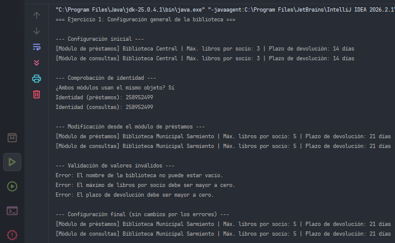

# Ejercicio 01 - Configuración General de una Biblioteca

## Descripción

Una biblioteca utiliza una aplicación de escritorio para gestionar sus operaciones. Los módulos de préstamos y consultas necesitan conocer el nombre de la institución, la cantidad máxima de libros por socio y el plazo de devolución. Antes, cada módulo creaba su propia configuración y los valores podían quedar desactualizados. Este ejercicio centraliza la configuración en una única instancia compartida por todos los módulos.

## Objetivos

- Implementar el patrón Singleton para centralizar la configuración de la biblioteca.
- Compartir una única instancia entre los módulos de préstamos y consultas.
- Reflejar en ambos módulos las modificaciones realizadas sobre la configuración.
- Validar los datos: rechazar nombres vacíos y valores numéricos menores o iguales a cero.
- Comprobar mediante una comparación de identidad (`==`) que ambos módulos utilizan el mismo objeto.

## Implementación del patrón Singleton

Se utiliza la variante **básica con inicialización perezosa (lazy)**:

- **Constructor privado (`private`):** impide crear instancias directamente desde el código cliente.
- **Atributo estático privado (`instance`):** almacena la instancia compartida.
- **Método estático (`getInstance()`):** crea la instancia cuando se solicita por primera vez y devuelve esa misma instancia en las llamadas posteriores.

Si `getInstance()` utiliza el modificador `synchronized`, la creación de la instancia también queda protegida frente a llamadas concurrentes a ese método.

## Propósito de las clases

- **`LibraryConfiguration`:** implementa el Singleton. Almacena el nombre de la biblioteca, el máximo de libros por socio y el plazo de devolución. Sus atributos son privados y sus métodos de modificación validan los datos.
- **`LoanModule`:** representa el módulo de préstamos. Obtiene la configuración compartida, la consulta y puede modificarla.
- **`QueryModule`:** representa el módulo de consultas. Obtiene y muestra la misma configuración compartida.
- **`Main`:** demuestra que ambos módulos utilizan el mismo objeto, que los cambios se reflejan en ambos y que las validaciones rechazan los valores inválidos.

## Concepto clave

El patrón Singleton permite que una clase tenga una única instancia y proporciona un punto de acceso global a ella. Como todos los módulos utilizan el mismo objeto, los cambios realizados en la configuración son visibles para los demás módulos.

La comparación de identidad mediante `==` permite comprobar que ambos módulos hacen referencia al mismo objeto.

## Resultado

## Conclusión

El patrón Singleton resuelve el problema de las configuraciones duplicadas al proporcionar una única fuente de información compartida. La comparación de identidad confirma que ambos módulos utilizan la misma instancia, mientras que las validaciones ayudan a mantener la consistencia de los datos.

Este ejercicio permite comprender cómo centralizar un estado compartido y cómo aplicar el patrón Singleton en una aplicación Java.
